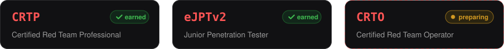

```
beacon> shell type C:\Users\iqlip\intro.txt
[*] Tasked beacon to run: type C:\Users\iqlip\intro.txt
[+] host called home, sent: 52 bytes
[+] received output:

    operator  : iqlip
    role      : red team operator
    scope     : active directory | ai security | osint
    habit     : if I do it twice on an engagement, I build a tool for it
```

#### Focus


#### Certifications



#### Arsenal

```
beacon> ls C:\Tools
[*] Tasked beacon to list files in C:\Tools
[+] host called home, sent: 19 bytes
[*] Listing: C:\Tools\

 Size     Type    Last Modified         Name
 ----     ----    -------------         ----
          dir     11/02/2026 21:14:07   BloodHound
          dir     10/28/2026 18:40:51   Certipy
          dir     10/28/2026 18:39:12   Impacket
          dir     11/11/2026 23:02:36   NetExec
 174kb    fil     10/03/2026 11:09:44   Certify.exe
 1mb      fil     11/14/2026 02:47:31   mimikatz.exe
 755kb    fil     09/15/2026 14:20:13   PowerView.ps1
 451kb    fil     09/15/2026 14:22:48   Rubeus.exe
 1mb      fil     11/02/2026 21:12:40   SharpHound.exe

beacon> shell where python powershell bash
[*] Tasked beacon to run: where python powershell bash
[+] host called home, sent: 59 bytes
[+] received output:
C:\Python312\python.exe
C:\Windows\System32\WindowsPowerShell\v1.0\powershell.exe
C:\Windows\System32\bash.exe
```
